# m3-minify-theme

Material 3 themes for [Dota 2 Minify](https://github.com/egezenn/dota2-minify).

| File | Description |
|---|---|
| `m3-dark.css` | Dark theme |
| `m3-light.css` | Light theme |
| `manifest.json` | Theme metadata |
| `notes.md` | Description |
| `preview.png` | Preview image for the registry |

## Customization

- `--md-source` — source color of the whole palette.

## Screenshots

Each color comes in dark and light. Change the color with `--md-source` at the top of the CSS.

### Purple (default)

| Dark | Light |
|---|---|
| 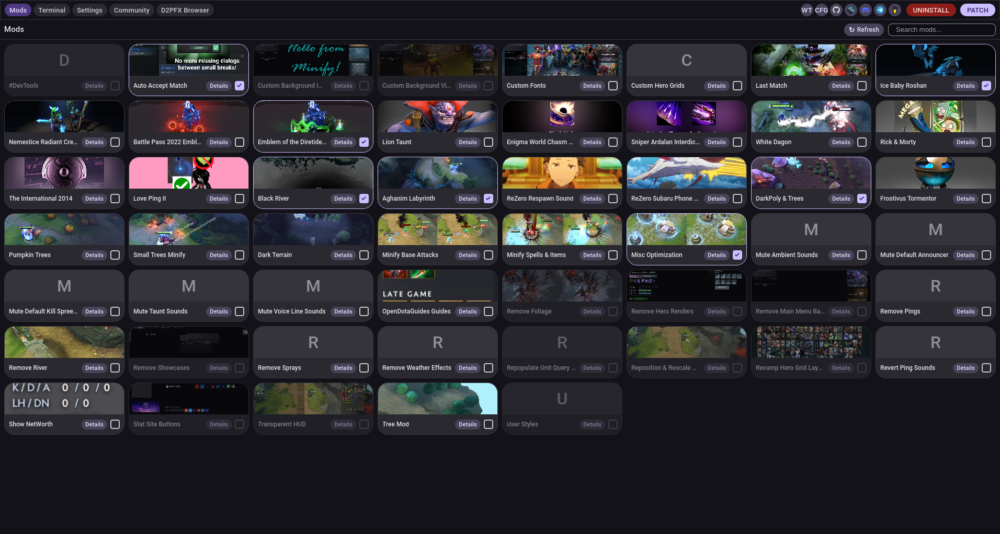 | 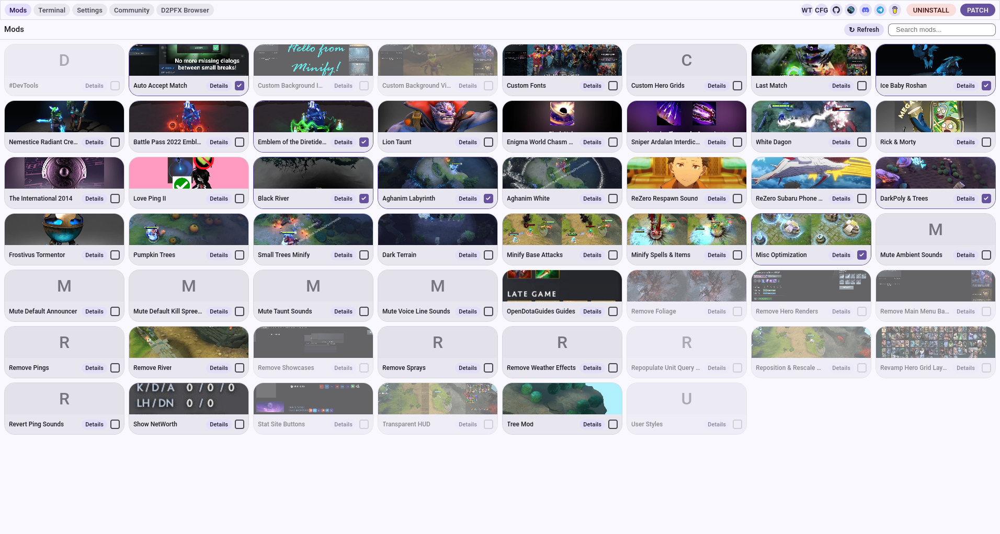 |
| 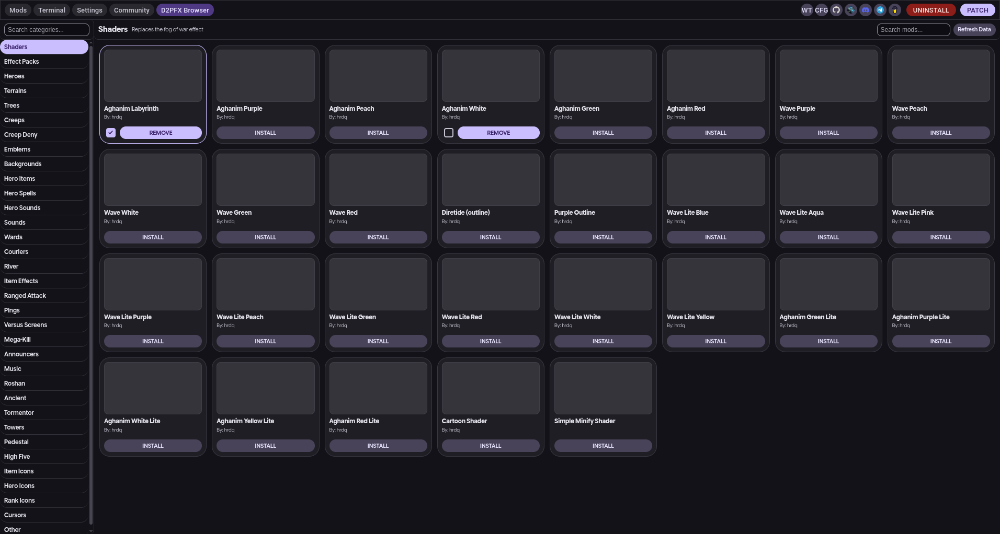 | 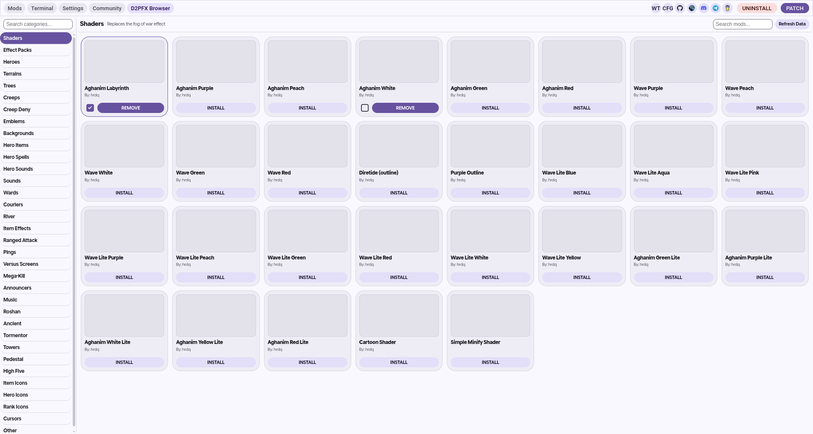 |

### Green

| Dark | Light |
|---|---|
| 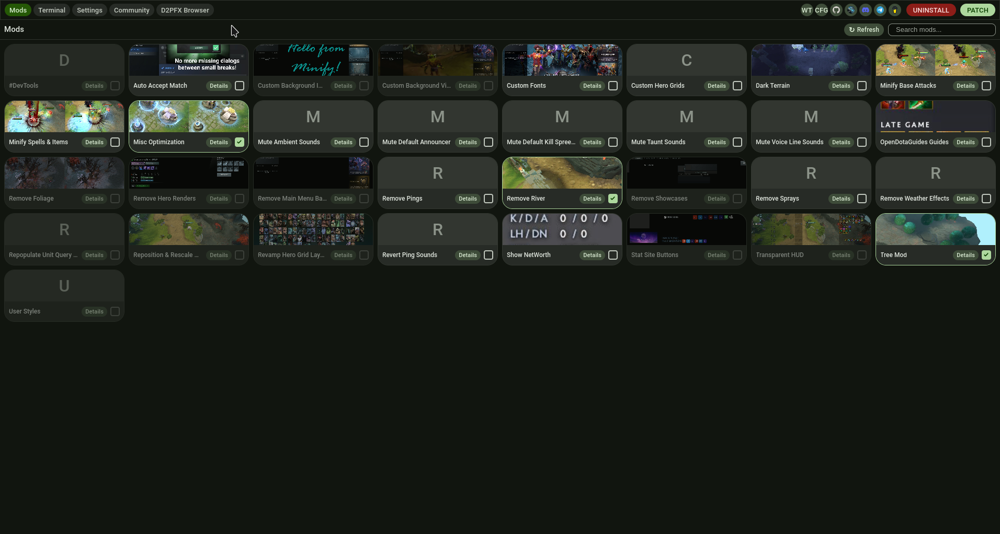 | 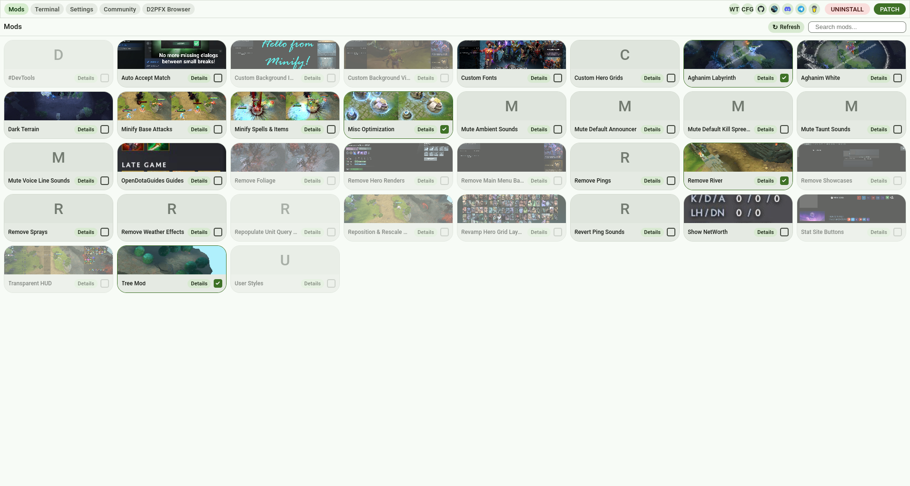 |
| 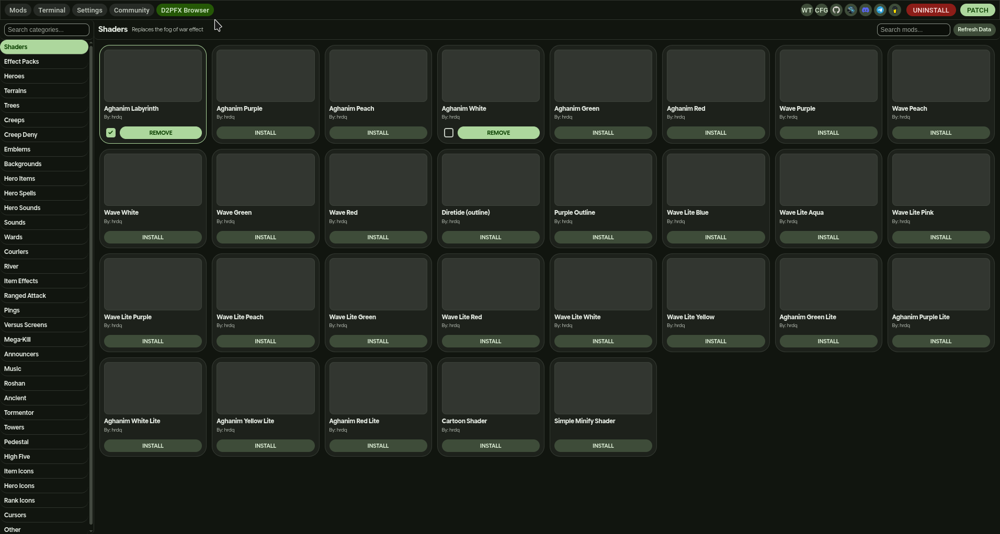 | 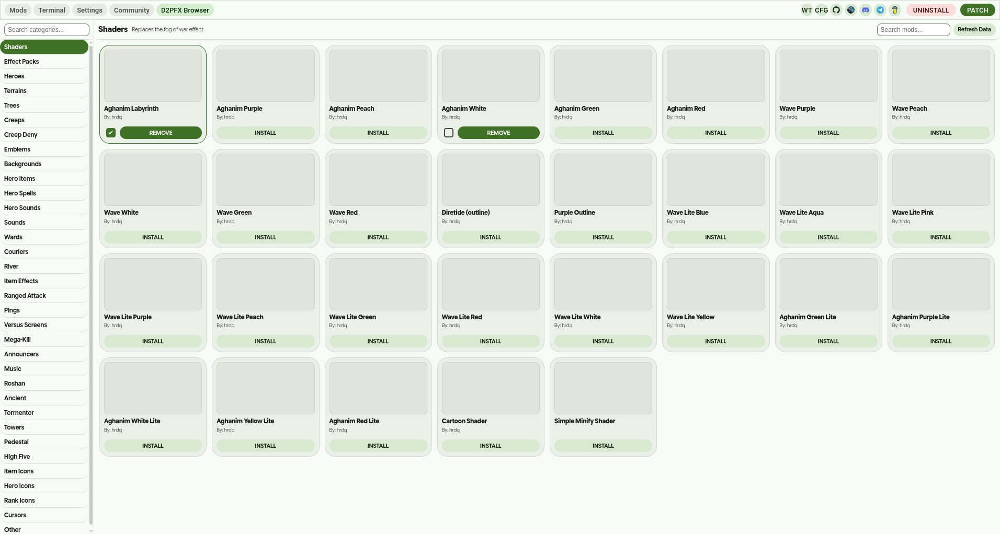 |

### Amber

| Dark | Light |
|---|---|
| 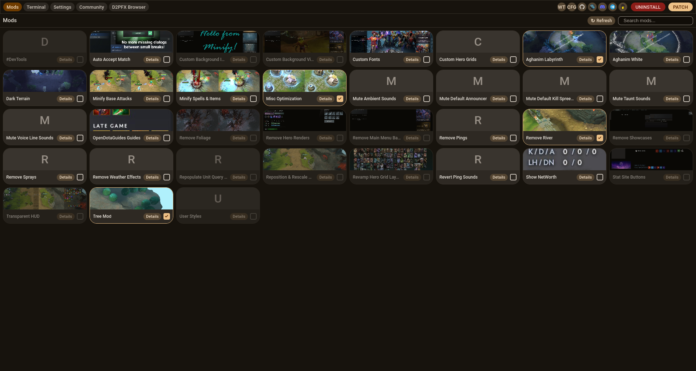 | 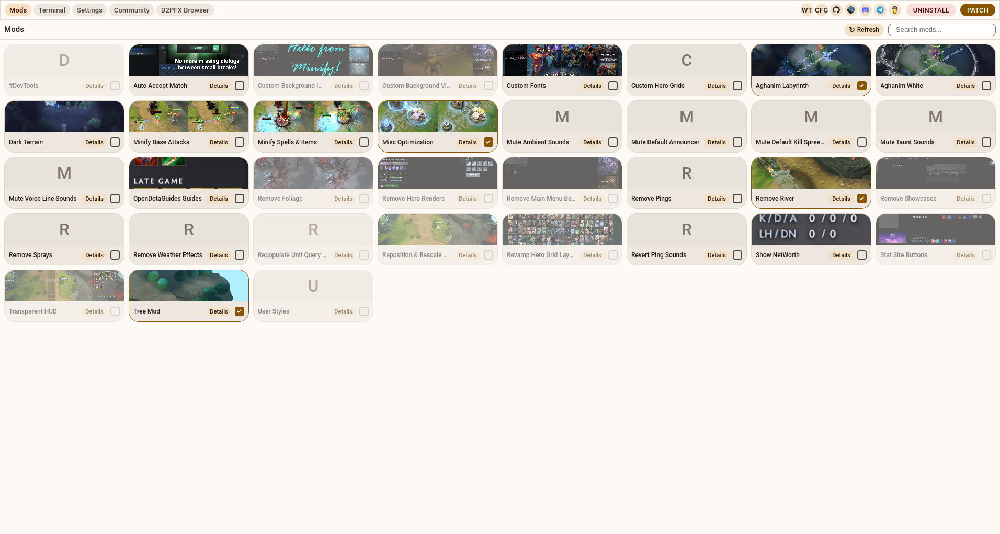 |
| 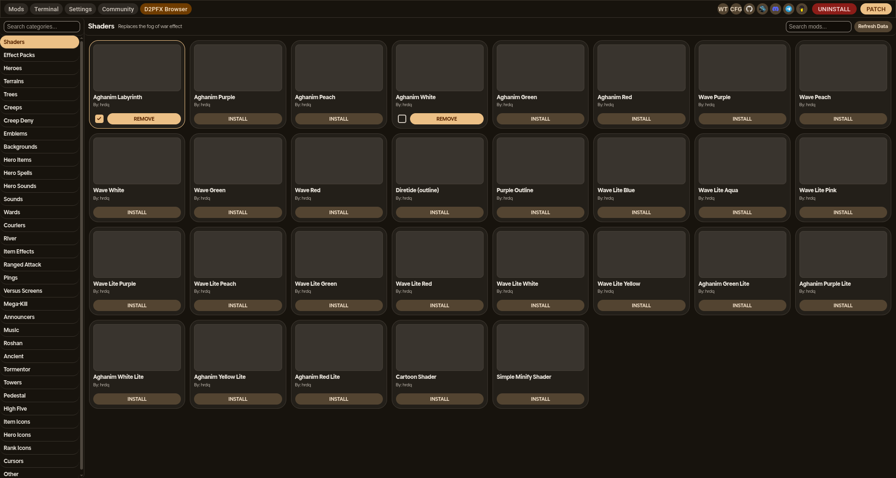 | 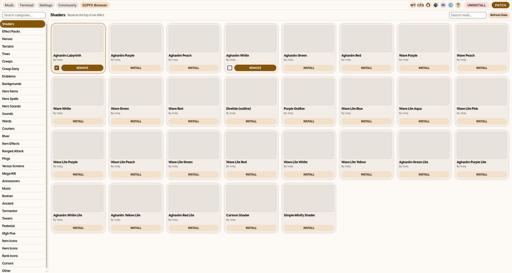 |